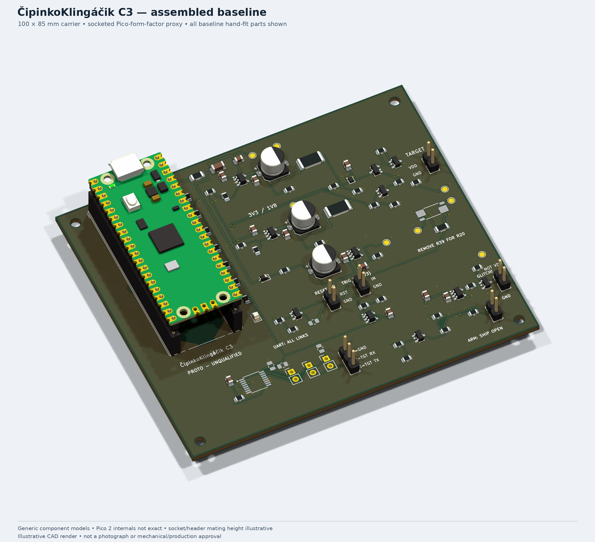

# ČipinkoKlingáčik

**A socketed Raspberry Pi Pico 2 voltage fault-injection carrier for supervised
hardware research.** Portable project/repository name: `cipinkoklingacik`.

**Release: `v0.1.0-alpha.1` · Hardware: C3 · Engineering prototype.**
The routed design passes static electrical/layout checks. **Firmware is not
implemented; no boards have been built or hardware-qualified.** This is not a
production-ready instrument or a guaranteed bypass of any device protection.



*Generic package models; the Pico is a disclosed form-factor proxy. Socket
height, colours and USB clearance are not mechanically approved.*

## What it provides

- A replaceable **Pico 2** on two 1×20 sockets; USB faces the board edge.
- Separate **MOSFET crowbar** and **3.3 V / 1.8 V current-bounded voltage selector**.
- Target disconnect, passive off discharge, open-drain reset and 3.3 V trigger input.
- Optional UART voltage translation and four-terminal current-measurement pads.
- A 100 × 85 mm, two-layer carrier with four M2.5 mounting positions.

The board uses established circuit techniques and manufacturer/KiCad assets;
it is a custom carrier, **not a fork of PicoGlitcher**. There is no SWD debugger
implementation. An external SWD probe and synchronization software are separate.

## Start here

| Need | Location |
| --- | --- |
| Open the design | [KiCad project](hardware/cipinkoklingacik.kicad_pro) · [hardware guide](hardware/README.md) |
| Read the circuit | [Electrical design](docs/DESIGN.md) · [schematic PDF](hardware/cipinkoklingacik.pdf) |
| Connect a target | [Wiring and SWD overview](docs/CONNECTING.md) |
| View the assembly | [3D views and PDF](hardware/visuals/README.md) |
| Review PCB evidence | [PCB review](hardware/PCB_REVIEW.md) · [review decisions](docs/REVIEW.md) |
| Inspect manufacturing data | [Prototype package](hardware/manufacturing/README.md) |
| Reproduce checks | [Build/check guide](docs/BUILD.md) |
| Understand remaining work | [Qualification checklist](docs/VALIDATION.md) · [parts policy](docs/PARTS.md) |

## Operating boundaries

- **10 mA total downstream load**, including target, bleeders and fitted interfaces.
  Both mux input branches retain **15 Ω** resistors; do not bypass them.
- Initial profiles: ≤100 nF / four dips or ≤1 µF / one dip, ≥20 ms between burst
  starts. At 100 nF the RC settling estimate is ~5.8 µs. **No settled 100 ns /
  100 nF promise.** Source labels are not calibrated target-pin voltages.
- Crowbar and target supply are different connectors. Externally powered crowbar
  targets leave the board's target-supply wire disconnected.
- **ARM ships open. No independent stuck-on timeout is fitted.** Use only
  expendable, authorized targets and qualify first with energy-limited dummy loads.
- Driver operation requires **4.90–5.25 V measured at VDD**. An arbitrary USB
  source/cable is not guaranteed to meet this. No hot-plug or misplug protection.

## Quick verification

```sh
python3 -m unittest discover -s tests -v
python3 scripts/design_calculations.py
```

These dependency-free checks inspect the included sources and exports; they
are **not a fresh KiCad run or hardware validation**. See [BUILD.md](docs/BUILD.md)
for full schematic regeneration, ERC, strict DRC/parity, exports and renders.
Never mix fabrication files from different manifests.

## Release and licensing

[Release notes](docs/RELEASE.md) describe the alpha handoff and local packaging.
Supplier sourcing/rotation, socket/USB fit, firmware, transient, thermal and
waveform qualification remain open. No components or boards have been ordered.

Original hardware is **CERN-OHL-P-2.0**; original software and prose are **MIT**.
Vendored KiCad assets retain their upstream licences and exceptions. See
[LICENSE](LICENSE), [NOTICE.md](NOTICE.md) and [CONTRIBUTING.md](CONTRIBUTING.md).
