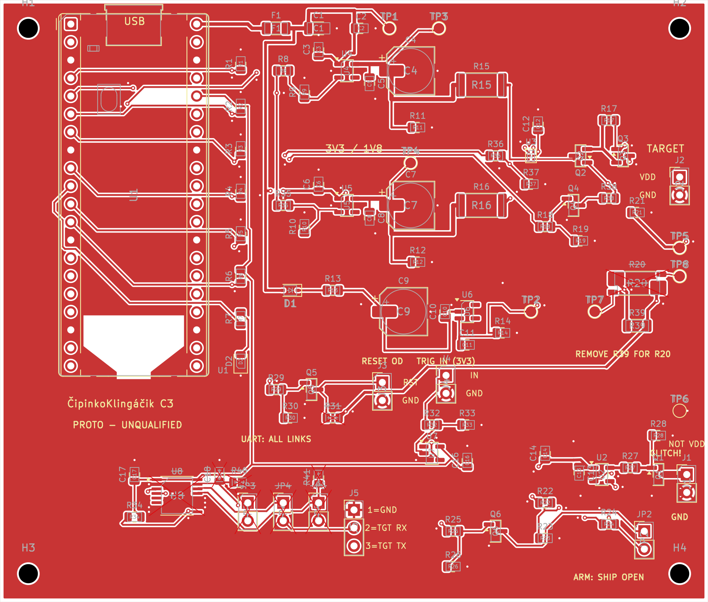

# C3 PCB review — ČipinkoKlingáčik

**Design-file review has converged for supervised engineering prototypes.**
Firmware, supplier approval and all physical qualification remain outstanding.
This review is not a production release or a measured pulse/thermal rating.

## Evidence

- KiCad **10.0.7** ERC: **0 errors / 0 warnings**.
- Strict PCB DRC: **0 violations / 0 unconnected / 0 schematic-parity issues**.
- **No ignored PCB checks and no project exclusions**; warnings also fail.
- Reports are hash-bound in [PCB status](cipinkoklingacik-pcb-status.json) and
  the [manufacturing manifest](manufacturing/manifest.json).
- Full pipeline and dependency-free regression checks cover pin/pad/net identity,
  native DNP, bypass locality, ground transitions, exports, coordinates, drills,
  stencil population and visual freshness. Four ERC defaults are disclosed in
  [hardware/README.md](README.md).

[Bottom copper](cipinkoklingacik-pcb-bottom.png) ·
[Layer-review PDF](cipinkoklingacik-pcb-review.pdf) ·
[Assembled views](visuals/README.md)

## Geometry reviewed

- **100 × 85 mm**, two-layer, 1.6 mm FR4 intent; nominal 1 oz copper still needs
  supplier approval. Four 2.7 mm NPTH holes for M2.5 mounting.
- **92 schematic + four mechanical footprints**, fully connected.
- Original critical local gate/crowbar/Kelvin routes were preserved during local
  Freerouting 2.5.0-assisted completion, followed by explicit cleanup and DRC.
  Final copper is authoritative; historical route-import files are not needed.
- Crowbar drain branch ~**3.06 mm / 1.0 mm wide**, U2 OUT→R27 ~**1.95 mm /
  0.4 mm wide**; gate, drain and Kelvin signal nets are top-side and via-free.
  Full gate-current return also includes bypass/driver GND/Q1 source copper.
- Reviewed bypass trace paths: U4/C5 and U5/C8 **3.86 mm**, U6 input/C10
  **2.96 mm**, U6 output/C11 **3.83 mm**, U2/C13 **2.15 mm**. C14 is distributed
  additional bypass (~7.33 mm), not adjacent bulk. These are not full-loop lengths.
- Both layers have filled GND pours. B.Cu contains signal routing and is **not
  an uninterrupted plane**. All **42 signal transitions** have a GND via within
  2 mm (observed max ~1.9 mm); **38 review-added stitches** are retained in the
  [return-review record](cipinkoklingacik-return-review.json).
- Socket/SMT ground pads use solid connections; five THT connector ground pads
  retain thermals. Assembly process must account for copper thermal mass.

## Accepted prototype compromises

- Q3→R39→J2 force route remains ~**48.6 mm / three transitions**, versus ~7.7 mm
  direct. The 15 Ω damping remains; actual fast-corner/cable/return behavior must
  be measured. No settled 100 ns/100 nF guarantee.
- Optional 0.1 Ω R20 has separate force1/4 and sense2/3 nets; TP7/TP8 are
  **13 mm apart**, not a tight differential pair. Initially use calibrated
  DC/low-bandwidth checks, not fast-pulse metrology. **Remove R39 first** and
  hand-solder R20 or use a reviewed assembly variant; no baseline paste on R20.
  Never put grounded scope clips on either live sense terminal.
- Identical two-pin headers are **not keyed**. Labels and pre-power cable/net
  checks mitigate supervised use; no misplug-protection claim.
- No independent stuck-on timer, universal USB supply, hot-plug, arbitrary
  external-voltage or industrial ESD protection is promised.

## Remaining release gates

Confirm actual target supply/current/capacitance; approve sourcing, rotations,
socket/USB mechanics, stackup and soldering process; implement firmware; build
prototypes and execute [VALIDATION.md](../docs/VALIDATION.md). In particular:
driver VDD **4.90–5.25 V**, power-state/retention/back-power waveforms, both rails'
short/foldback/thermal behavior and actual glitch/trigger/gate waveforms.

The published name/library migration changes titles and artwork only; electrical
connectivity, component UUIDs, placement, pad geometry, tracks, vias and outline
were compared with the pre-rename design. See [REVIEW.md](../docs/REVIEW.md).
