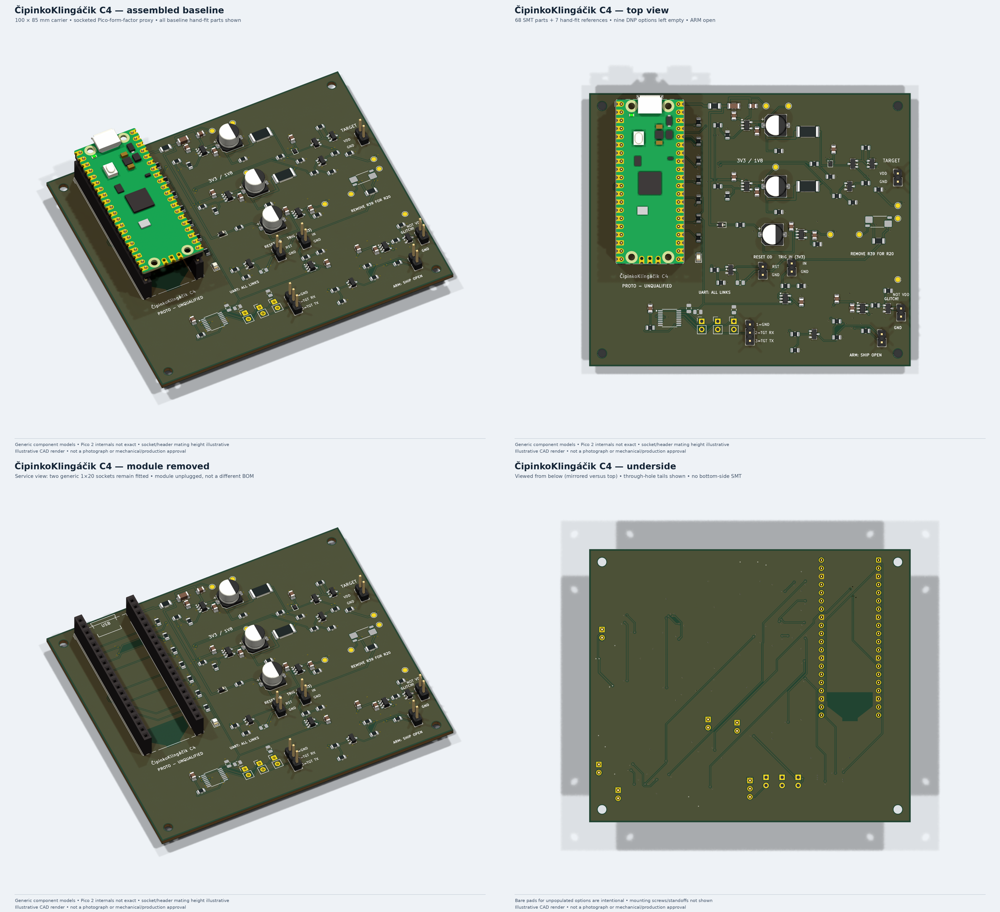

# ČipinkoKlingáčik C4 — assembly visuals

Illustrative KiCad raytraces of the checked baseline layout, **not photographs,
fabrication files or approved mechanical envelopes**.



- [Assembled isometric](cipinkoklingacik-C4-isometric.png)
- [Top](cipinkoklingacik-C4-top.png)
- [Underside](cipinkoklingacik-C4-bottom.png) — viewed from below, mirrored versus top
- [Module removed](cipinkoklingacik-C4-module-removed.png) — sockets remain fitted
- [Four-page PDF](cipinkoklingacik-C4-assembly-views.pdf)

The baseline includes **68 SMT + seven hand-fit references**, with R39 fitted,
ARM open, and U8/C18/JP3–JP5/R20/R31/R40/R41 empty. No screws/standoffs or cables
are shown. Native DNP model absence is checked by reloading temporary render-only
boards; the authoritative PCB is not changed.

**The Pico is a common-form-factor proxy, not an exact Pico 2 model.** Generic
8.50 mm sockets and an illustrative 11.04 mm module/header offset do not approve
the Samtec mating stack. Package cosmetics and green finish are illustrative.
USB/cable/part-envelope checks still require the actual components. The official
Pico 2 STEP download was unavailable; this proxy is explicitly disclosed.

Models come from the installed [KiCad 3D library](https://gitlab.com/kicad/libraries/kicad-packages3D),
not newly licensed vendor geometry. [manifest.json](manifest.json) records their
hashes, the source board/project, population and all delivered-image/PDF hashes.

Regenerate with the KiCad 10 Flatpak/Packages3D extension and Pillow installed:

```sh
.venv/bin/python scripts/render_pcba.py
python3 -m unittest discover -s tests -v
```

See [BUILD.md](../../docs/BUILD.md), [PCB_REVIEW.md](../PCB_REVIEW.md) and
[VALIDATION.md](../../docs/VALIDATION.md). Static checks and attractive renders
do not establish hardware qualification.
